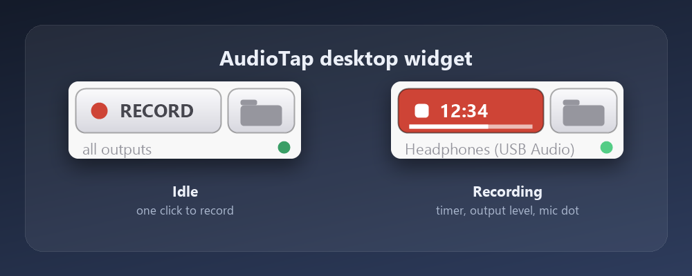
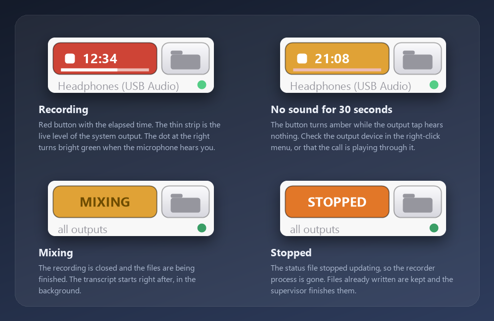
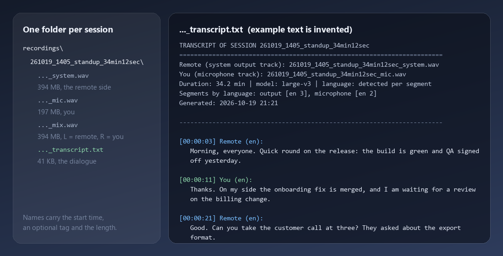

# AudioTap: Windows Call Recorder with Local Transcription

AudioTap is a Windows call recorder for Zoom, Microsoft Teams and Google Meet. It records system audio (WASAPI loopback) and your microphone as two separate tracks, then transcribes both locally with faster-whisper, so every line of the transcript is attributed to you or to the other side without guessing who is speaking. It works offline and keeps recordings on your own disk, for anyone who wants recordings and searchable transcripts of their own calls, such as interviews, sales calls and meetings, without uploading audio to a cloud service.

A small desktop widget starts and stops recordings. A Python app does the capture, mixing and transcription. Built with Python and PowerShell (WinForms). No cloud account, no API key.



## Features

- Records what you hear: WASAPI loopback taps the digital mix that Windows sends to your headphones or speakers, so remote voices come out clean (no microphone pointed at a speaker).
- Records your microphone at the same time, as its own track.
- Writes three files per call: the system track, the microphone track and a stereo mix (left = what you heard, right = what you said).
- Speaker separation by track: the two tracks are transcribed separately and merged on timestamps, which is more reliable than guessing speakers on a mixed file.
- Local transcription with faster-whisper. Model, device (CUDA or CPU), language and speaker labels are configurable. Language is detected per segment, so a call that switches languages is fine.
- Removes the far side from the microphone transcript when your microphone picked it up from the speakers.
- Crash-safe recording: WAV headers are updated on every chunk, so a killed recorder still leaves playable files, and a background supervisor finishes any session that has no transcript.
- Taps every output device by default, so the call is captured even when it does not play through the Windows default device.
- A desktop widget that sits below all windows: one click to record, a live timer and level strip, a button that opens the last transcript.
- Runs invisibly: no console windows, no tray icon, no telemetry.

## Install

Requirements: Windows 10 or 11, Windows PowerShell 5.1 (built in), Python 3.9 to 3.13, no admin rights. An NVIDIA GPU is optional. ffmpeg is optional.

1. Download the ZIP from [Releases](https://github.com/datonko-gi/audiotap/releases) and unpack it anywhere, or clone the repo:

   ```
   git clone https://github.com/datonko-gi/audiotap.git
   ```

2. Install the Python packages once (PyAudioWPatch, numpy, faster-whisper):

   ```
   python -m pip install -r requirements.txt
   ```

3. Double-click `install.bat`. It puts the supervisor and the widget into your Startup folder and starts both. The widget appears at the bottom right of your main screen.

The first transcription downloads the Whisper model from Hugging Face and caches it (about 3 GB for `large-v3`, about 0.5 GB for `small`). To check your audio devices before the first call, run `app\devices.bat`. `app\selftest.bat` plays a short tone and proves the loopback tap works; the tone is audible, so do not run it during a call.

## Usage

The widget:

- Click **RECORD** to start. The button turns red and shows the elapsed time. The thin strip under the time is the live level of the system output; the dot at the bottom right is the microphone (bright green when it hears you, grey when microphone recording is off).
- Click the red button to stop. It shows **MIXING** while the files are finished, then the transcript starts in the background.
- The folder button opens Explorer with the last session's file selected (the transcript once it exists, the mix before that), or the recordings folder if there is no session yet.
- Drag the widget to move it. The position is saved.
- Right-click for the menu: **Output device** (all devices or one specific device), **Record microphone** (on or off), **Open recordings folder**, **Close widget**.
- The button turns amber when the output tap has heard nothing for 30 seconds, and shows **STOPPED** if the recorder process has died.



The command line works without the widget:

```
python app\audiotap.py --mic --name call          record output + microphone, Ctrl+C to stop
python app\audiotap.py --list                     list output taps and microphones
python app\audiotap.py --mic --device "USB" --seconds 3600
python app\audiotap.py --mic --mix-mode mono --mic-gain 1.5 --no-mix
app\record-call.bat                               the first command with a console window
app\stop.bat                                      stop a running recording cleanly from another window
```

Other useful flags: `--out DIR` (recordings folder), `--transcribe` (start transcription when the recording closes), `--quiet` (one status line every 10 seconds). Run `python app\audiotap.py --help` for the full list.

What a session looks like on disk, and what the transcript contains:



## Configuration

Settings live in `%LOCALAPPDATA%\AudioTap\config.json`. The supervisor creates the file with the defaults on its first start; every key is optional, and changes are picked up without a restart.

| key | default | meaning |
| --- | --- | --- |
| `recordings_dir` | empty | Where sessions are written. Empty means a `recordings` folder next to the app. Example: `%USERPROFILE%\Music\AudioTap`. |
| `transcribe_model` | `large-v3` | Any faster-whisper model name (`tiny`, `base`, `small`, `medium`, `large-v3`) or a path to a local model folder. |
| `transcribe_device` | `auto` | `auto` uses CUDA when it works and falls back to CPU. `cuda` insists on CUDA. `cpu` never touches the GPU. |
| `transcribe_compute_type` | empty | Empty means `float16` on CUDA and `int8` on CPU. Other values: `float32`, `int8_float16`. |
| `language` | empty | Empty detects the language per segment. Set a code such as `en`, `de` or `es` to force one. |
| `label_remote`, `label_you` | `Remote`, `You` | Speaker labels in the transcript. |
| `ffmpeg` | empty | Full path to `ffmpeg.exe`. Empty looks on PATH. Without ffmpeg the WAV files go to faster-whisper directly. |
| `min_transcribe_mb` | `10` | Sessions smaller than this are skipped by the supervisor (clicks and silence). |
| `retain_days` | `0` | `0` never deletes anything. A number deletes a session's audio that many days after the recording, once its transcript exists, and keeps the transcript. Tiny sessions (below `min_transcribe_mb`) that never got a transcript are removed too. A large session without a transcript is never deleted. |
| `poll_seconds`, `sweep_min_age_s` | `20`, `120` | Supervisor tick, and how old a session must be before it is finished automatically. |

Without an NVIDIA GPU the CPU is used. `large-v3` is slow on a CPU, so set `"transcribe_model": "small"` (or `base`) and leave `transcribe_device` on `auto`. With an NVIDIA GPU, faster-whisper needs the CUDA 12 cuBLAS and cuDNN 9 libraries (see the faster-whisper README); when they are missing, AudioTap falls back to the CPU and logs why.

Other files:

- `%APPDATA%\AudioTapWidget\data.json`: widget position, microphone on or off, chosen output device.
- `%LOCALAPPDATA%\AudioTap\`: live status, logs, locks and per-session notes. `supervisor.log` and `postprocess_<session>.log` are the places to look when something does not happen.
- `<recordings>\<session>\`: `<session>_system.wav`, `<session>_mic.wav`, `<session>_mix.wav`, `<session>_transcript.txt`. A session is named `yymmdd_HHMM`, an optional tag and the length, for example `261019_1405_call_34min12sec`. Folders can be renamed in Explorer; every script finds a session by the file names inside.

Disk use is about 1.7 GB per recorded hour (48 kHz, 16-bit WAV, three files). Set `retain_days` to delete old audio automatically and keep the transcripts.

## How it works

```
Startup -> supervisor.py (pythonw, one instance)
             keeps the widget alive, finishes sessions without a transcript,
             cleans stale status, writes a heartbeat
Startup -> AudioTapWidget.vbs -> audiotap-widget.ps1
             front panel; restarts the supervisor if its heartbeat goes stale

audiotap.py       one process per recording: loopback taps + microphone, crash-safe WAV
postprocess.py    repairs headers, builds the mix, runs the transcription, idempotent
transcribe.py     faster-whisper on each track, merge on timestamps, drop echo
```

- The recorder opens every WASAPI loopback endpoint through PyAudioWPatch and a silent keep-alive stream on each, because loopback delivers no buffers while nothing plays and idle stretches would otherwise vanish from the timeline. The keep-alive is inaudible.
- The widget and the recorder talk through `status.json` (written twice a second while recording). The widget never imports anything from Python.
- The supervisor and the widget watch each other, so either one coming back brings the other back. A process started by Windows without a console never opens a window: children use `CREATE_NO_WINDOW`, and waits use process handles instead of polling.

## Privacy

- Audio never leaves your computer. Recordings and transcripts are plain files in your recordings folder.
- AudioTap itself makes no network connections and sends no telemetry. The only downloads are the Python packages (pip) and, the first time you use a Whisper model, the model files from Hugging Face, which are cached afterwards. To work fully offline, download a model once and set `transcribe_model` to the folder that holds it.
- The widget reads `status.json`, `last.json` and `config.json` and writes its own `data.json`. It does not read your audio.
- Recordings are not encrypted. Keep the recordings folder on a disk you trust, and mind cloud-synced folders such as OneDrive if you move it.

## Legal: recording consent

Recording a conversation without the knowledge or consent of the people on it is illegal in many places. The rules differ by country and, in the United States, by state. Federal law and most states allow recording with the consent of one party, but California, Florida, Illinois, Maryland, Massachusetts, Pennsylvania, Washington and several other states require the consent of every party to the call. In many countries, including those under the GDPR, privacy and data-protection duties apply on top of that: a lawful basis, notice to the people recorded, limits on how long you keep the recording. Workplace and cross-border calls can be governed by yet another set of rules.

You are solely responsible for how you use AudioTap. Tell everyone on the call that you are recording and get their consent before you start, follow your employer's policies, and delete recordings you are not allowed to keep. Note that AudioTap records outside the call app and shows nothing to the other participants, so a call app's own recording notice does not apply to it. This section is general information, not legal advice. The authors give no warranty and accept no liability for how the software is used (see [LICENSE](LICENSE)).

## Uninstall

Run `uninstall.bat`. It removes the two Startup shortcuts and stops the supervisor and the widget. Recordings and settings are kept. To remove everything, also delete this folder, `%LOCALAPPDATA%\AudioTap` and `%APPDATA%\AudioTapWidget`. A recording that is running at that moment is not stopped; stop it from the widget first.

## Troubleshooting

- **RECORD does nothing, or the packages are reported missing.** The widget and the supervisor start the Python that `pythonw.exe` resolves to when you run `install.bat`. Install the packages with that same interpreter (`python -m pip install -r requirements.txt`), then run `install.bat` again. `%LOCALAPPDATA%\AudioTap\widget.log` shows which interpreter the widget picked, and `python_exe.txt` in the same folder holds the pin.
- **The system track is silent.** The call is not playing through a tapped device, or nothing was playing. By default every output device is tapped; if you chose one device in the right-click menu, switch back to **All output devices**. Bluetooth headsets that switch to hands-free mode during a call appear as a different device, which the default setting also covers. `app\devices.bat` lists what Windows offers.
- **No transcript, or it takes very long.** Open `%LOCALAPPDATA%\AudioTap\postprocess_<session>.log`. On a CPU, `large-v3` can take several times the length of the call; set `transcribe_model` to `small` or `base`. The supervisor retries a session only once, so after fixing the cause run `python app\postprocess.py --session <session> --force`.
- **A very long recording has no `_mix.wav`.** The mix is built in memory, which can run out on a call of several hours. The log says `mix failed`; the system and microphone tracks and the transcript are not affected, because the transcript is made from the two tracks.
- **Disk fills up.** Three uncompressed WAV files per call add up to about 1.7 GB per hour. Set `retain_days` in `config.json`, or delete old session folders by hand.

## More widgets

More desktop widgets for Windows, plus a guide and a boilerplate for building your own: [windows-desktop-widgets](https://github.com/datonko-gi/windows-desktop-widgets).

## License

MIT. See [LICENSE](LICENSE).
